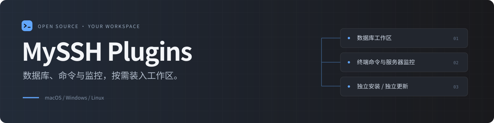
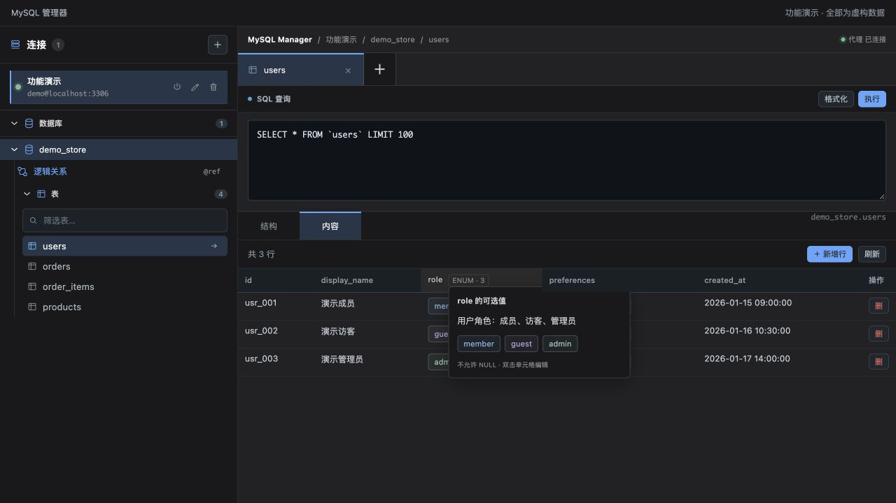
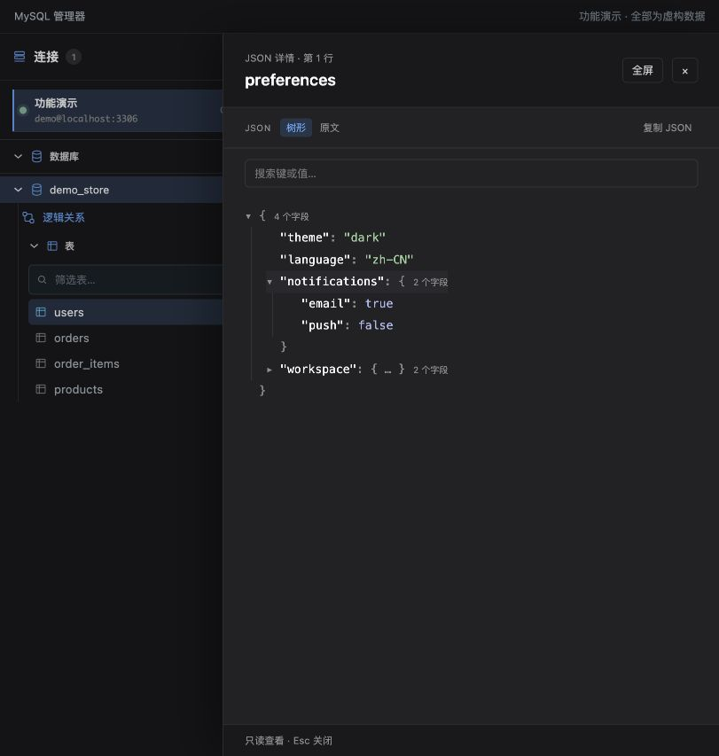

<p align="center">
  
</p>

<p align="center">
  <a href="https://github.com/Chengyunlai/my-ssh"></a>
  <a href="https://github.com/Chengyunlai/my-ssh-plug/actions/workflows/ci.yml"></a>
  
</p>

<p align="center">
  <a href="#安装只需一个市场地址"><strong>安装插件</strong></a> ·
  <a href="#mysql-工作台">MySQL 工作台</a> ·
  <a href="#按需选择你的工具">全部插件</a> ·
  <a href="docs/mysql-logical-relations.md">COMMENT 语法</a> ·
  <a href="https://github.com/Chengyunlai/my-ssh">返回 MySSH</a>
</p>

MySSH 的独立插件市场。把数据库浏览、常用命令、服务器监控和 WSL 入口装入现有工作区，按需安装，独立更新。

## MySQL 工作台

**从一行数据，看到背后的结构。**

库表导航、SQL 查询与多表标签放在一起。打开表先看内容，中文注释解释字段，JSON 用详情面板展开，ENUM 用可选值展示。



| 浏览更顺手 | 复杂内容更清楚 | 结构可以分享 |
| --- | --- | --- |
| 内容优先、多表标签、可拖动侧栏 | JSON 树形与搜索、ENUM 下拉编辑、二进制显示 | COMMENT 逻辑关系、JOIN 草稿、交互式 HTML |

### 注释里的关联，成为可以浏览的关系图

`@ref` 声明单字段引用，`@relation` 描述多字段配对，`@mapping` 表达业务映射。画布自动布局，支持分组、搜索、平移缩放与连线详情；中文说明和机器声明分开阅读。

<p align="center">
  
</p>

有效字段关联可以生成完整条件的 JOIN 草稿，审阅后执行；业务映射不生成 JOIN。无需创建物理外键，也不会根据同名字段猜测关联。

[阅读 COMMENT 声明语法](docs/mysql-logical-relations.md)

### 把结构说明，交给一个 HTML 文件

导出当前范围的表结构、中文注释与关系快照。接收者可以搜索、筛选、缩放和查看字段详情，无需安装 MySSH 或连接数据库。

文件内嵌样式、脚本与快照，不依赖 CDN，不包含业务数据行或连接凭据。结构名与 COMMENT 会随文件分享；内容变化后需要重新导出。每次最多 100 条声明、最大 2 MiB。

<details>
<summary><strong>查看 JSON 详情与数据浏览</strong></summary>
<br />

JSON 支持树形 / 原文切换、键值搜索、复制和全屏。

<p align="center"></p>

表内容提供 JSON 摘要、枚举标签和分页操作。

<p align="center"></p>

</details>

[完整功能与使用方式](src/mysql-manager/README.md) · [语法与能力边界](docs/mysql-logical-relations.md)

## 按需选择你的工具

| 插件 | 适合什么场景 | 使用要求 |
| --- | --- | --- |
| **MySQL 管理器** · 1.4.0 | 库表与 SQL、JSON / ENUM、关系画布与 HTML 导出 | 桌面 MySSH ≥ 1.3.0；Kubernetes 来源需新版宿主 |
| **命令手册** · 1.2.0 | 按关键字查找 100 条常用 Linux 命令，点击复制 | MySSH ≥ 0.1.0 |
| **服务器监控** · 0.2.0 | 查看当前 SSH 会话的 CPU、内存、磁盘、网络与运行时间 | MySSH ≥ 1.3.2 |
| **WSL 终端** · 1.1.0 | 打开本地 WSL / Ubuntu 终端 | Windows · MySSH ≥ 0.1.0 |

四个插件也提供 MySSH `1.5.0+` 的终端入口。桌面与终端的功能范围不同；关系画布、JSON 详情和交互式 HTML 导出属于桌面工作区。

## 安装只需一个市场地址

1. 打开 MySSH 的「设置 → 插件市场」。
2. 填入以下地址，点击「加载市场」。
3. 选择插件安装并启用。

```text
https://chengyunlai.github.io/my-ssh-plug/registry.json
```

默认连接由宿主管理本机数据库代理，无需手动启动服务。Kubernetes 来源由宿主发现服务并建立本机通道；权限仍由集群与数据库账号决定。

[下载 MySSH](https://github.com/Chengyunlai/my-ssh/releases/latest) · [MySQL 连接说明](src/mysql-manager/README.md#安装与连接)

<details>
<summary>开发与贡献</summary>

```bash
npm ci
npm run typecheck
npm test
npm run build
```

构建生成 `dist/registry.json` 与独立插件资源。推送主分支后，现有 GitHub Actions 部署插件市场。

React ESM 由宿主加载，Node Companion Runtime 独立打包。开发契约与权限边界见 [MySSH 插件规范](https://github.com/Chengyunlai/my-ssh/blob/master/docs/PLUGIN.md)。

</details>

<p align="center"><sub>截图使用当前组件与虚构数据，仅展示功能，不含真实账号、业务记录或内部库表。</sub></p>
