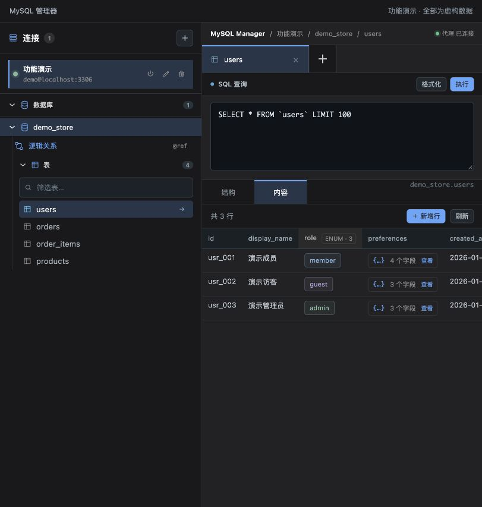

<p align="center">
  
</p>

<h1 align="center">my-ssh-plug</h1>

MySSH 的插件市场仓库,与核心仓库([my-ssh](../my-ssh))独立维护、独立发版。

## 插件列表

| 插件 | id | 版本 | 分类 | 兼容 | 官方 | 说明 |
| --- | --- | --- | --- | --- | --- | --- |
| MySQL 管理器 | `mysql-manager` | 1.4.0 | 效率工具 | MySSH ≥ 1.3.0；K8s 需新版宿主 | ✅ | 库表与注释、SQL/JSON/ENUM、逻辑关系画布及交互式 HTML 导出 |
| 命令手册 | `command-book` | 1.2.0 | 终端增强 | MySSH ≥ 0.1.0 | ✅ | 终端底部命令搜索条:100 条常用 Linux 命令,关键字匹配,点击复制 |
| WSL 终端 | `wsl-terminal` | 1.1.0 | 终端增强 | MySSH ≥ 0.1.0 | ✅ | 在 MySSH 中打开本地 WSL/Ubuntu 终端(仅 Windows) |
| 服务器监控 | `server-monitor` | 0.2.0 | 监控 | MySSH ≥ 1.3.2 | ✅ | 当前 SSH 会话的 CPU、内存、磁盘、网络与运行时间可视化监控 |

## MySQL 工作区

- 库表导航与内容优先浏览，多表标签和可调整侧栏。
- 表与字段中文注释、JSON 详情、ENUM 标签和下拉编辑。
- 使用 COMMENT 声明单字段、多字段和表级业务映射，无需创建物理外键。
- 关系画布支持分组、搜索、自动布局、连线详情、平移缩放与 JOIN 草稿。
- 导出单文件交互式 HTML，分享结构、注释和关系快照；不包含业务行或连接凭据。
- 可选 Kubernetes 服务来源，由宿主管理本机连接通道。

使用与边界见 [MySQL 管理器](src/mysql-manager/README.md)，声明语法见 [COMMENT 逻辑关系](docs/mysql-logical-relations.md)。

## 功能截图

当前组件使用虚构的商店数据演示，不包含真实连接、账号、业务记录或内部库表。

**表内容与复杂字段摘要**



**COMMENT 逻辑关系画布**


更多 [JSON 详情与 ENUM 展示](src/mysql-manager/README.md#复杂字段)。

## 安装

在 MySSH「设置 → 插件市场」加载官方市场：

```text
https://chengyunlai.github.io/my-ssh-plug/registry.json
```

选择插件安装并启用。核心与插件独立升级；Kubernetes 来源需要具备对应能力的新版宿主。终端入口需要 MySSH `1.5.0+`，终端与桌面功能范围见各插件说明。

## 开发与贡献

```bash
npm ci
npm run typecheck
npm test
npm run build
```

构建生成 `dist/registry.json` 与独立插件资源。插件开发契约见 [MySSH 插件规范](https://github.com/Chengyunlai/my-ssh/blob/master/docs/PLUGIN.md)。推送主分支后由现有 GitHub Actions 部署插件市场。
